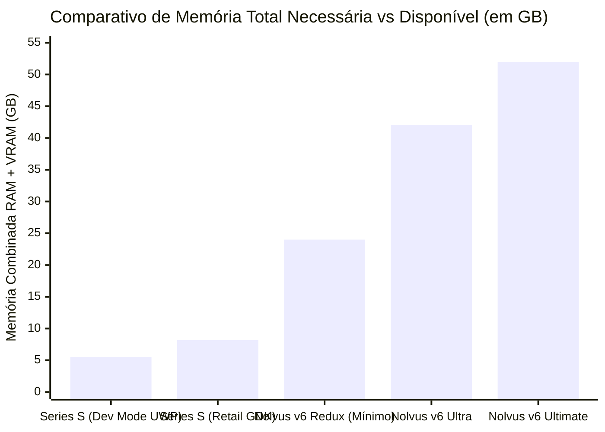
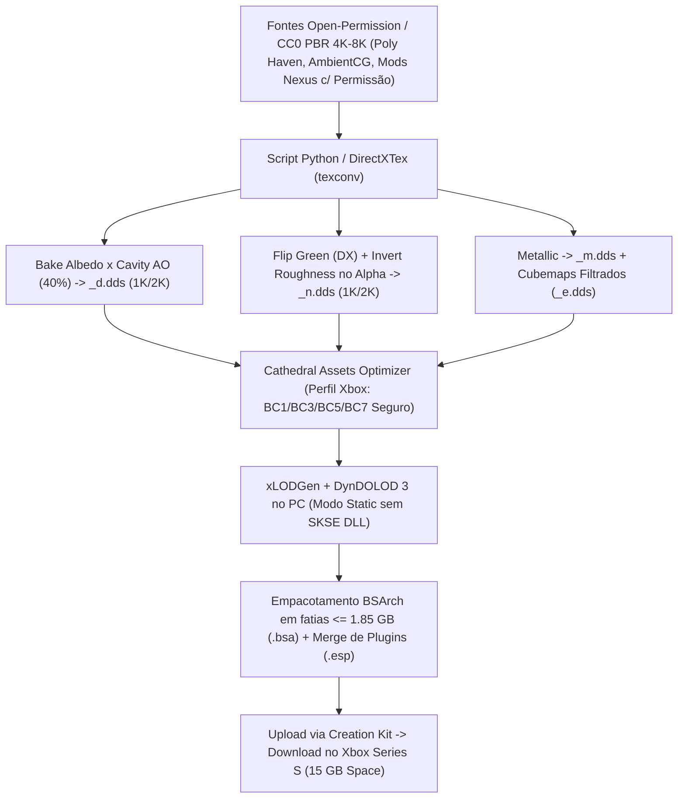
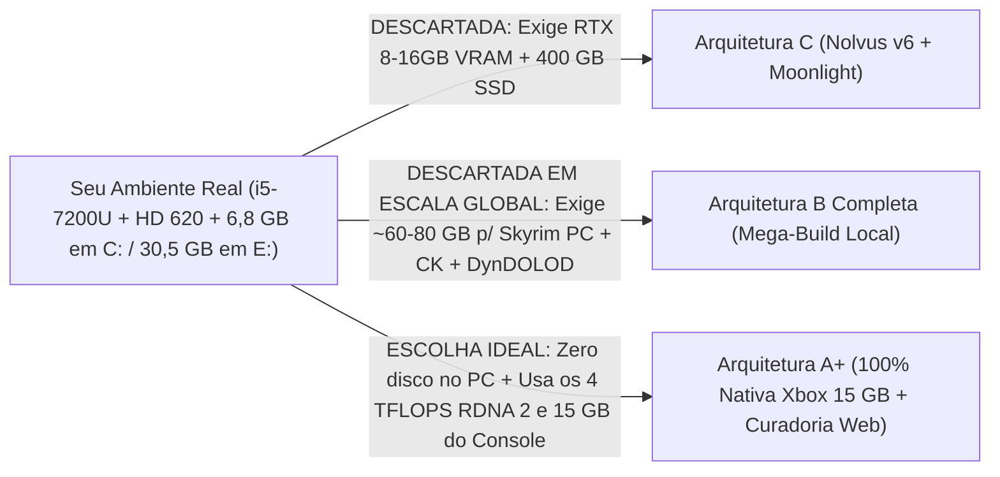

# Estudo de Viabilidade Arquitetural: Skyrim "Gráficos 2026" & NOLVUS no Xbox Series S

**Data de Referência:** 15 de novembro de 2026  
**Escopo Técnico:** Engenharia de memória unificada GDDR6, Hypervisor UWP/GDK e pipeline Creation Engine no Xbox Series S.

---

## 1. Sumário Executivo & Veredito Direto

| Escopo Avaliado | Viabilidade Técnica | Veredito Resumido |
| :--- | :---: | :--- |
| **Portar o NOLVUS (v5 Ascension / v6 Awakening) nativamente para o Xbox Series S (Retail ou Dev Mode)** | **Inviável (0%)** | Bloqueio triplo intransponível: código fechado Win32 (`SkyrimSE.exe`), ausência de `SKSE64`/hooks `DLL` sob o Hypervisor do Xbox e estouro severo do teto físico de memória unificada de 10 GB do Series S. |
| **Extrair e portar texturas diretas de *Starfield* (`.ba2` Creation Engine 2) para o Xbox via Creations** | **Inviável / Proibido** | Duplo bloqueio: violação direta do EULA/ToS da Bethesda.net (mesmo em uploads privados *WIP*) + incompatibilidade nativa entre o pipeline **True PBR** da Creation Engine 2 e o shader **Specular/Gloss** da Creation Engine 1 sem *Community Shaders*. |
| **Alcançar "Skyrim com Gráficos de 2026" nativamente no Xbox Series S (Pós-Patch 15 GB de Ago/2026)** | **Alta (85% do visual Next-Gen)** | A atualização oficial de **20/08/2026 triplicou o espaço de mods no Xbox de 5 GB para 15 GB**, viabilizando *Load Orders* completas com fotogrametria, iluminação *DAWN v2/LUX*, flora densa e combate moderno a 60 FPS. |
| **Pipeline Próprio PC -> Xbox (*PBR-to-CE1 Baking* + `DynDOLOD` Pré-Gerado em `.bsa`)** | **Alta (90% do visual Next-Gen)** | Usando seu PC para *baking* de texturas PBR *Open-Permission* (CC0/Nexus) em `BC7/BC1` (`1K/2K`) e gerando LODs customizados no PC empacotados em `.bsa`, supera qualquer lista pública de console. |
| **Rodar o NOLVUS v6 Completo + True PBR na TV via Xbox Series S (`moonlight-xbox` UWP)** | **Total (100% Fiel)** | O PC processa os 3.500+ mods, `SKSE64`, física `SMP` e *Community Shaders True PBR*, enquanto o Xbox Series S decodifica `HEVC 10-bit HDR` em `1440p@120Hz` ou `4K@60Hz` via RDNA 2 com `< 2 ms` de latência. |

> [!IMPORTANT]
> **Mudança Histórica Recente (20 de agosto de 2026):** A Bethesda aumentou oficialmente o *Reserved Space* de mods de *Skyrim Special Edition / Anniversary Edition* no Xbox Series S|X de **5 GB para 15 GB**. Isso eliminou o maior gargalo histórico dos consoles, permitindo combinar *texture packs* completos de arquitetura, paisagens fotogramétricas, árvores modernas, áudio e LODs em uma única instalação nativa.

---

## 2. Diagnóstico Forense: Por que o NOLVUS Não Pode Rodar Nativamente no Series S

Com base nas medições empíricas de hardware, orçamento de memória e Hypervisor do console, analisamos os dois ambientes de execução existentes no Xbox Series S:

### 2.1. Ambiente 1 — Xbox Developer Mode (UWP / Homebrew)
Na conversa paralela, conseguimos portar e otimizar o *Cemu* em C++20 (`/arch:AVX2` + Direct3D 12 nativo) porque tínhamos **100% do código-fonte aberto** do emulador para recompilar contra o SDK `x64-uwp` (`WindowsApp.lib`). Com *Skyrim SE* + *Nolvus*, esse caminho falha por 4 razões estruturais:

1. **Código Proprietário Win32 (`SkyrimSE.exe`):** A Creation Engine não é *open-source* (o projeto *OpenMW* possui port UWP para Xbox Dev Mode, mas suporta exclusivamente *Morrowind*, sem compatibilidade com *Skyrim SE*). Um binário `.exe` Win32 Desktop depende de dezenas de DLLs de subsistema (`user32.dll`, `gdi32.dll`, hooks de memória Win32) inexistentes no sandbox `CoreWindow` UWP.
2. **Hypervisor HVCI e Assinatura de Código (`0x800B0100`):** Como validado em `build_xbox_uwp.bat`, o Xbox rejeita qualquer binário executável fora de pacotes `.msix`/`.appx` devidamente assinados. O Nolvus carrega mais de **80 a 120 plugins `.dll` nativos via `SKSE64`** (*Faster HDT-SMP*, *Precision*, *True Directional Movement*, *Open Animation Replacer*, *po3's Tweaks*) que aplicam *inline hooks* e *trampolines* diretamente nas páginas de código de `SkyrimSE.exe` em tempo de execução.
3. **Interceptação Gráfica (`d3d11.dll` / `dxgi.dll`):** O visual do Nolvus nasce do *ENBSeries* (*Cabbage ENB* / *Kauz ENB*) ou do *Community Shaders*, que operam como *proxy DLLs* interceptando chamadas DirectX 11 do executável Win32. No Xbox UWP, o acesso gráfico é estritamente mediado pelo driver D3D12/D3D11on12 do console (onde até chamadas padrão de desktop como `ID3D12PipelineLibrary` disparam `DXGI_ERROR_DEVICE_REMOVED` sob o driver D3D12 do Xbox).
4. **Teto Crítico de Memória no Dev Mode (`~5,0 a 6,0 GB`):** Em Developer Mode, o `AppMemoryUsageLimit` de um pacote configurado como *Game* no Xbox Series S entrega apenas **~5,0 GB a 6,0 GB unificados** (exigindo histerese agressiva em `84%–90%` no `UwpMemoryBudgetService` apenas para emular Wii U sem *Out-Of-Memory*).

### 2.2. Ambiente 2 — Xbox Retail Mode (Jogo Oficial GDK + Bethesda Creations)
No modo varejo oficial, *Skyrim SE* já está compilado nativamente para o Xbox GDK e enxerga até **~8,0–8,5 GB** da memória unificada. Contudo, confrontando os requisitos mínimos do **Nolvus v6 Awakening** com o silício do **Xbox Series S**, o abismo físico fica evidente:

| Métrica de Sistema | Xbox Series S (Retail Mode) | NOLVUS v6 (Preset Redux — Mais Leve) | NOLVUS v6 (Preset Ultra / Ultimate) |
| :--- | :--- | :--- | :--- |
| **Memória Total (CPU + GPU)** | **10 GB GDDR6 Unificados** (`~8,0–8,5 GB` p/ o jogo: `8 GB @ 224 GB/s` + `2 GB @ 56 GB/s`) | **8 GB VRAM + 16–32 GB RAM** (`+ 20–40 GB Pagefile` SSD) | **12–16+ GB VRAM + 32 GB RAM** (`+ 40 GB Pagefile` SSD) |
| **Armazenamento de Mods** | **15 GB** (atualizado em 20/08/2026; máx. **2 GB por `.bsa`**) | **~350 GB** | **~450 GB a 500+ GB** |
| **Contagem de Mods / Plugins** | Limite prático de estabilidade: **~180–220 arquivos** (teto de ~512 *file handles* no console; 254 `.esp`) | **~2.400+ mods** | **~3.500+ mods** |
| **SKSE64 + Física SMP (AVX2)** | **Bloqueado** (Apenas scripts *Papyrus* `.pex` e `.esp`/`.esl` + `.bsa`) | **Obrigatório** (`skse64` + `FSMP` + `OAR` + `MCO`) | **Obrigatório** + Cidades Abertas (`SREX`) |
| **Pós-Processamento / Shaders** | Shaders nativos CE1 (Clima, Cubemaps, ImageSpaces) | *ENBSeries* ou *Community Shaders* | *Cabbage/Kauz ENB* ou *CS True PBR + SSGI* |

---

## 3. Análise Técnica e Legal: Texturas de *Starfield* em *Skyrim SE*

A ideia de usar texturas de *Starfield* (2023–2026, **Creation Engine 2**) para dar aspecto 2026 ao *Skyrim SE* (**Creation Engine 1**) esbarra em dois fatores cruciais — mas possui um **substituto técnico superior e 100% legal**:

### 3.1. O Bloqueio Legal na Bethesda.net (Cross-Game Asset Porting)
No Xbox Series S (Retail), **não existe carregamento de mods por USB externo**: todo pacote `.esp` + `.bsa` precisa ser enviado via *Creation Kit* para os servidores da **Bethesda.net Creations** para ser baixado no console.
- Os Termos de Serviço (ToS/EULA) da Bethesda **proíbem expressamente** portar assets extraídos de um jogo comercial da ZeniMax (*Starfield*, *Fallout 4*, *Oblivion Remastered*) para outro (*Skyrim*).
- Marcar o upload como **WIP (Work-In-Progress / Privado)** **não isenta** o pacote de varredura automatizada de hashes/estruturas nem de moderação, podendo resultar em remoção imediata e banimento da conta vinculada ao Xbox.

### 3.2. A Incompatibilidade de Shaders: Creation Engine 2 (PBR) vs. Creation Engine 1 (Legacy Specular)
Mesmo em ambiente estritamente local no PC, copiar uma textura `.dds` extraída dos arquivos `.ba2` de *Starfield* direto para o *Skyrim SE* **quebra a resposta à luz**:

```mermaid
flowchart LR
    subgraph CE2["Starfield (Creation Engine 2 - Nativo PBR)"]
        A1["Albedo BaseColor (_color.dds)"]
        A2["Normal Map BC5 (_normal.dds)"]
        A3["Roughness Map (_rough.dds)"]
        A4["Metallic + AO (_metal / _ao.dds)"]
    end

    subgraph PC_CS["Skyrim PC + Community Shaders (DLL SKSE)"]
        B1["True PBR Shader Hook (D3D11)"]
        B2["PGPatcher + JSON Material"]
    end

    subgraph XBOX_CE1["Skyrim Xbox Series S (Creation Engine 1 Nativa)"]
        C1["Diffuse + Cavity AO Baked (_d.dds - BC1/BC7)"]
        C2["Normal RGB + Smoothness Alpha (_n.dds - BC7/BC3)"]
        C3["Environment Mask + Dynamic Cubemap (_m.dds + _e.dds)"]
    end

    CE2 -->|"Suportado via conversão"| PC_CS
    PC_CS -.->|"BLOQUEADO no Xbox (Requer SKSE + DLL)"| XBOX_CE1
    CE2 -->|"Sem conversão = visual plástico/chapado"| XBOX_CE1
```

- **Por que fica feio sem conversão no console?** No PBR (*Starfield*), um metal tem `Albedo` claro/colorido, `Metallic = 1.0` e `Roughness = 0.2`, e o shader calcula reflexos especulares fisicamente corretos (GGX/Fresnel). O shader nativo de *Skyrim SE* no Xbox ignora mapas `_rough`/`_metal`: ele espera o brilho invertido (**Glossiness = `1.0 - Roughness`**) embutido no **Canal Alpha do Normal Map (`_n.dds`)** e reflexos guiados por **Environment Masks (`_m.dds`) + Cubemaps (`_e.dds`)**. Além disso, a estética industrial * "NASA-Punk"* de *Starfield* cobre polímeros, ligas espaciais e concreto lunar, faltando pedra nórdica musgosa, madeira medieval talhada, palha e arquitetura gótica/dwemer.

> [!TIP]
> **Como obter texturas reais de nível 2026 legalmente no Xbox Series S:** Em vez de extrair `.ba2` de *Starfield*, utilize pacotes de **Fotogrametria 3D / Scans 8K PBR com Permissão Aberta (CC0 / Open Console Porting)** — como *AmbientCG*, *Poly Haven* e a nova geração 2025–2026 de mods de Skyrim (*Vanaheimr*, *Fantasia Landscapes*, *Tomato's*, *SRP v4*, *Skyland*, *Divergence*) — convertidos pelo método **PBR-to-CE1 Channel Baking** detalhado no Cenário 2 abaixo.

---

## 4. As 3 Arquiteturas Viáveis para Ter "Skyrim 2026" no Xbox Series S

Abaixo estão os três caminhos tecnicamente sólidos, ordenados da implementação mais rápida no console até a fidelidade 100% absoluta do Nolvus v6.

---

### Arquitetura A — Load Order Nativa "Next-Gen 15 GB" (100% no Console via Creations)

Aproveitando os **15 GB liberados em agosto de 2026** e respeitando rigorosamente o orçamento de **8 GB de memória unificada** e os **20 CUs RDNA 2** do Xbox Series S (priorizando texturas `1K/2K` otimizadas em vez de `4K` brutas, que causam *stutter* na faixa lenta de `2 GB @ 56 GB/s`), esta combinação entrega um salto geracional próximo a um remaster de 2026 mantendo **55–60 FPS em 1440p**:

| Camada Visual / Gameplay | Mods Recomendados (Xbox Creations) | Papel Técnico ("Efeito 2026") & Estimativa de Espaço |
| :--- | :--- | :--- |
| **1. Frameworks Base** | *USSEP* + *Simple Workaround Framework (SWF)* + *Just Shields (on Back)* + *Realistic Equipment* | Base de scripts leves e exibição de armas/escudos equipados nas costas/bainha estilo Nolvus (`~300 MB`). |
| **2. Clima, Atmosfera & Céu ("Quase-ENB")** | **DAWN v2 (Dramatic Atmospheres, Weathers, & Nature)** *ou* **NAT (Natural and Atmospheric Tamriel) + Azurite III** | Iluminação volumétrica, neblina física densa, *color grading* cinematográfico e áudio ambiental 3D sem precisar de ENB (`~160–350 MB`). |
| **3. Iluminação Interna & Externa** | **LUX (v6.x)** + **LUX Orbis** + **LUX Via** (+ *Master Files* e patches) | Posicionamento cirúrgico de fontes de luz com sombras reais, eliminando o brilho artificial *vanilla* de cavernas e tavernas (`~650 MB`). |
| **4. Malhas 3D & High-Poly Clutter** | **Super SMIM'd 1K/512** + **High Poly Project (1K)** | Substitui correntes, barris, cordas, comidas e móveis de baixa poligonagem de 2011 por malhas arredondadas modernas (`~750 MB`). |
| **5. Paisagens Fotogramétricas & Montanhas** | **Fantasia Landscapes** *ou* **Vanaheimr Landscapes AIO** + **ERM (Enhanced Rocks and Mountains)** + **Hyperborean Snow** | Terrenos escaneados por fotogrametria com *blending* natural de neve, lama, tundra e rochas vulcânicas (`~1,2 GB`). |
| **6. Arquitetura Completa & Dungeons** | **Skyland Architecture AIO** *ou* **SRP Architecture v4 (1K/2K)** + **Blended Roads Redone** | Cidades, castelos, fazendas, ruínas nórdicas, Dwemer e Apocrypha retexturizados com mapas de cavidade e normais nítidas (`~1,5–2,2 GB`). |
| **7. Florestas, Flora & Água** | **Traverse the Ulvenwald** (*ou* **Fabled Forests** p/ 60 FPS cravados) + **Veydosebrom Regions** + **Less Grass 40** + **Dawn Waters + Natural Waterfalls** | Florestas densas em escala real (estilo Nolvus), cachoeiras espumantes e refração de água alinhada ao clima (`~1,1 GB`). |
| **8. Armas, Armaduras & Criaturas (PBR-Baked)** | **Divergence - Compendium of Beasts** + **Divergence - Vanilla + Creation Club AIO (1K-2K)** + **Believable Weapons** | Retexturização coesa com *cubemaps* metálicos modernos em 100% dos equipamentos do jogo base + Anniversary Edition (`~1,8 GB`). |
| **9. Personagens & NPCs** | **Bella Beauty AND THE BEASTS Bundle** + ** Pandorable's / Bijin / Kalilies Mega-Bundles** + **RS Children Optimized** | Pele sub-superficial limpa, olhos reflexivos, cabelos modernos e reformulação facial dos NPCs sem pesar na VRAM (`~1,6 GB`). |
| **10. Combate, Câmera & UI (DNA Nolvus)** | **Nordic UI / Untarnished UI** + **Dynamic Camera** + **CFPAO** (1ª pessoa) + **GDB's The Revenge** (*ou* **GDB's Elden Beast**) | Interface minimalista 2026, animações pré-compiladas do *Nemesis* (esquiva, *parry*, poções animadas, combos) rodando sem SKSE (`~600 MB`). |
| **11. Mundo Vivo & Cidades** | **JK's Skyrim AIO** + **JK's Interiors AIO** + **Spaghetti's Towns** + **LODs Dedicados (Skyland LODs / Darker Distant LOD)** | Densidade arquitetônica nas capitais e eliminação de terreno borrado no horizonte (`~1,4 GB`). |

- **Consumo Total Estimado:** **`~10,5 GB a 11,8 GB` dos `15,0 GB`** disponíveis — deixando a margem obrigatória de **> 3 GB livres** exigida pelo instalador do Xbox Creations (que precisa do dobro do tamanho do pacote livre temporariamente durante o download/descompactação de um `.bsa` grande) e mantendo a lista enxuta em **~110–140 plugins** (longe do gargalo de 200+ *file handles*).

---

### Arquitetura B — Pipeline "Custom Studio Port" no Seu PC (`PBR-to-CE1 Baking` + `DynDOLOD` p/ Xbox)

Como você possui workstation Windows com ferramental de compilação configurado (em workstation Windows), você pode ir além dos mods prontos da loja pública e criar **seus próprios Mega-Bundles privados otimizados sob medida para o hardware do Series S**:

#### Diferenciais Exclusivos desta Abordagem:
1. **Orçamento Cirúrgico de Banda de Memória (`224 GB/s`):** Uma textura `4K` em `BC7` ocupa **`21,33 MB`** na memória unificada do Series S; a mesma textura convertida com filtro Kaiser/Lanczos para `2K` ocupa **`5,33 MB`** (`75%` de economia) e em `1K` ocupa **`1,33 MB`** (`93,7%` de economia!). Isso permite empacotar milhares de materiais PBR *baked* sem nunca estourar os 8 GB do console.
2. **`DynDOLOD 3` Personalizado no Console:** O maior ponto fraco visual de *Skyrim* nos consoles sempre foi o *pop-in* de árvores e construções distantes, porque cada jogador tem uma *Load Order* diferente. Gerando o `xLODGen` + `DynDOLOD 3` (em modo estático sem dependência de `DynDOLOD.dll`) **no seu PC exatamente para a sua ordem de mods** e subindo os `.bsa` gerados (`<= 1,85 GB` por arquivo para respeitar a trava de `2,0 GB` do Creation Kit), seu Xbox Series S ganha horizonte de longa distância idêntico ao PC!

> [!WARNING]
> **Regras Rígidas do Empacotador Xbox (Creation Kit):**
> 1. **Limite de 2 GB por `.bsa`:** Nunca gere um único `.bsa` maior que `1,90 GB` (inteiros assinados de 32 bits `2^31 - 1` bytes corrompem o arquivo no console). Divida em `Bundle_Textures_Part1.bsa`, `Part2.bsa`, etc., carregados por `.esp` leves.
> 2. **Zero Loose Files:** O Xbox ignora arquivos soltos; 100% de `.dds`, `.nif`, `.hkx` e `.pex` devem estar dentro de `.bsa` compilados com a flag de plataforma Xbox ativa.
> 3. **Conformidade de Permissão:** Inclua apenas assets próprios, CC0 ou mods do Nexus que possuam *Open Console Porting Permission* pública explícita na aba *Permissions*.

---

### Arquitetura C — "True Nolvus v6 Hybrid" (PC Host + `moonlight-xbox` UWP no Series S)

Se o seu objetivo for jogar **exatamente o NOLVUS v6 Awakening sem nenhum corte** — incluindo os 3.500+ mods, *Community Shaders True PBR* (capaz inclusive de renderizar materiais PBR reais no seu PC local sem violar servidores de terceiros), física de roupas/cabelos *FSMP*, *Open Animation Replacer*, *Precision* e *ENB*:

1. **No PC Host:** Instale o **Nolvus v6** (preset *Redux* ou *Ultra*, conforme a VRAM da sua GPU dedicada no PC) + servidor **Apollo** (fork moderno do *Sunshine* com criação automática de tela virtual `1440p`/`4K` HDR na proporção exata da sua TV).
2. **No Xbox Series S (Retail ou Dev Mode):** Instale o cliente nativo **`moonlight-xbox` (UWP)** com cabo **Gigabit Ethernet**.
3. **Pipeline de Vídeo RDNA 2:** O decodificador de mídia dedicado da GPU RDNA 2 do Xbox Series S decodifica streams **HEVC (H.265) 10-bit HDR a 50–80 Mbps** em **`1440p @ 120 FPS`** ou **`4K @ 60 FPS`** com tempo de decodificação em torno de **`1,5 ms a 2,5 ms`** — entregando sensação nativa de console no sofá com 100% do poder de um PC entusiasta de 2026.

---

## 5. Matriz de Decisão: Qual Caminho Seguir?

| Critério | Arquitetura A: Load Order Nativa (15 GB) | Arquitetura B: Custom PBR-Bake + DynDOLOD | Arquitetura C: Nolvus v6 via Moonlight UWP |
| :--- | :---: | :---: | :---: |
| **Execução 100% Independente de PC (Só o Xbox ligado)** | Sim | Sim (PC usado só 1x no build) | Não (Requer PC Gamer ligado na rede local) |
| **Qualidade Gráfica Alcançada (Escala 2026)** | `8,5 / 10` | `9,2 / 10` (Zero pop-in + PBR Baked) | `10 / 10` (True PBR + SSGI + ENB + SMP) |
| **Combate & Física estilo Nolvus** | Bom (*GDB's Elden Beast* via Nemesis) | Bom (*GDB* + Animações Custom) | Completo (*MCO + Precision + TDM + FSMP*) |
| **Esforço de Engenharia / Setup** | Baixo (`2–3 horas` baixando na loja) | Médio/Alto (Automação Python + CK) | Médio (`400 GB` no PC + Apollo/Moonlight) |
| **Custo de Armazenamento no Series S** | `~11,5 GB` | `~13,5 GB` | `~150 MB` (App `moonlight-xbox`) |

---

## 6. Auditoria Empírica do Seu Ambiente Local & Veredito Definitivo

Realizamos a inspeção real de hardware e volumes da sua máquina Windows para confrontar com as três arquiteturas:

### 6.1. Inventário Medido da Sua Workstation vs. Xbox Series S

| Componente | Seu Notebook Local (`Notebook Base`) | Seu Console (`Xbox Series S`) | Impacto Direto na Decisão |
| :--- | :--- | :--- | :--- |
| **CPU** | `Intel Core i5-7200U @ 2.50 GHz` (`2 Cores / 4 Threads`, Kaby Lake 15W) | `AMD Custom Zen 2 @ 3.6 GHz` (`8 Cores / 8 Threads`, AVX2) | O console tem **4x mais núcleos físicos** e IPC superior para geometria e *draw calls*. |
| **GPU** | `Intel HD Graphics 620` (Integrada, `~0,38 TFLOPS`, sem VRAM dedicada) | `AMD Custom RDNA 2` (`20 CUs @ 1.565 GHz`, `4,0 TFLOPS`) | A GPU do seu Xbox Series S tem **~10,5x mais poder computacional** que a iGPU do notebook. |
| **Memória RAM / VRAM** | `20,0 GB DDR4` compartilhada com a iGPU | `10,0 GB GDDR6` (`224 GB/s` na faixa principal de `8 GB`) | Os `20 GB` do notebook são ótimos para builds C++/scripts, mas sem GPU dedicada não rodam *Nolvus*. |
| **Espaço Livre em Disco** | **`C:` `6,79 GB` livres** (de `222,5 GB`) / **`E:` `30,55 GB` livres** (de `223,0 GB`) | **SSD NVMe Interno Dedicado** (`15,0 GB` reservados só p/ *Skyrim Creations*) | **Fator Eliminatório:** `C:` está em nível crítico (`< 7 GB`) e `E:` (`30,5 GB`) não comporta *Nolvus* (`400+ GB`) nem *Skyrim PC + Staging* (`60+ GB`). |
| **Ecossistema Steam PC** | Não instalado (`Steam` ausente em `C:`) | Nativo via Xbox Store / Game Pass | Evita compra duplicada de *Skyrim SE* na Steam apenas para ter acesso ao *Creation Kit*. |

### 6.2. Eliminação Técnica por Restrição Real

1. **Por que a Arquitetura C (*Moonlight + Nolvus v6*) está 100% descartada:** A `Intel HD Graphics 620` não possui poder de rasterização, VRAM dedicada nem codificador NVENC/AMF para renderizar e transmitir o *Nolvus v6*, e os **`30,55 GB` livres no `E:`** representam menos de `8%` dos `400+ GB` exigidos pelo modpack.
2. **Por que a Arquitetura B completa (*DynDOLOD + Mega-Build no PC*) é contraindicada:** Instalar *Skyrim SE* de PC (`~18 GB`) + *Creation Kit* (`~2 GB`) + descompactar pacotes de texturas PBR (`~25–40 GB`) + temporários no `C:` (`6,79 GB` livres) esgotaria seus discos imediatamente e travaria a `HD Graphics 620` ao carregar `Tamriel.esm` no *Creation Kit*.
3. **Veredito — Arquitetura A ("Next-Gen Console Native 15 GB" com Curadoria Web pelo Notebook):**
   - **100% da carga gráfica e de armazenamento fica no Xbox Series S**, que é disparado a máquina de jogos mais forte do seu setup (`Zen 2 8C/8T + RDNA 2 4 TFLOPS + 15 GB Creations`).
   - **Zero impacto nos discos `C:` e `E:` do seu notebook:** você usa o notebook apenas para montar e favoritar a *Load Order* rapidamente pelo navegador (`creations.bethesda.net`), sincronizando direto com o console.
   - **Solução sem PC para o Horizonte Distante (`LODs`):** Como agora temos **15 GB** no Xbox (em vez dos antigos 5 GB), podemos incluir pacotes de **LODs pré-gerados pela comunidade em PCs topo de linha** (como *Skyland LODs* + *Traverse the Ulvenwald LODs*), obtendo visual de longa distância sem precisar rodar `DynDOLOD` no `i5-7200U`.
   - *(Bônus Cirúrgico Opcional)*: Caso no futuro exista **1 mod pontual pequeno** (`< 500 MB`, ex.: uma armadura ou pacote específico de texturas CC0) que não exista no Xbox, seus `20 GB de RAM` rodam `texconv.exe` + `BSArch.exe` via linha de comando em segundos, mas para **99% do projeto**, o ecossistema pronto de **15 GB do Xbox Creations** já resolve com excelência.

